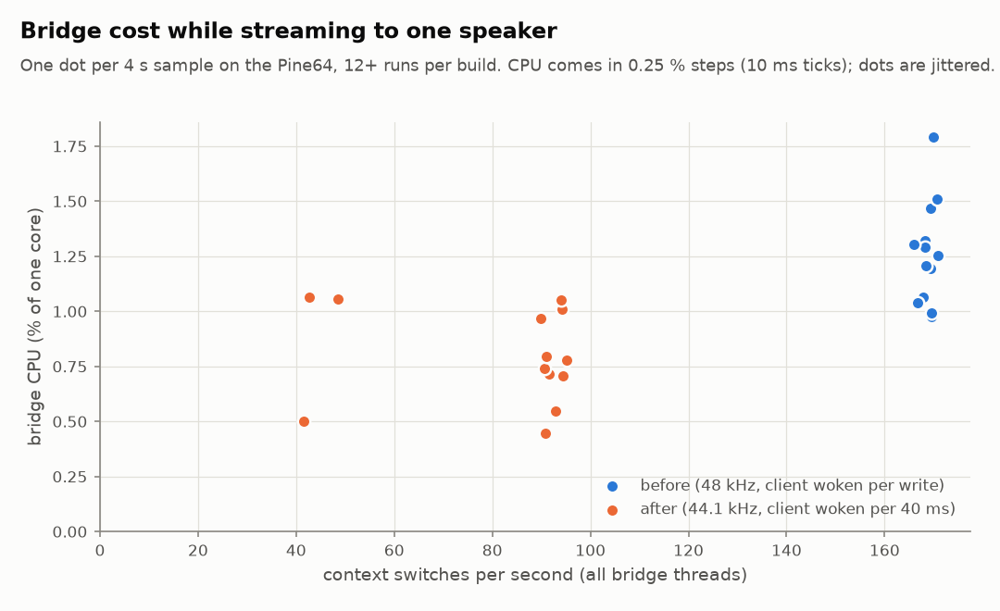
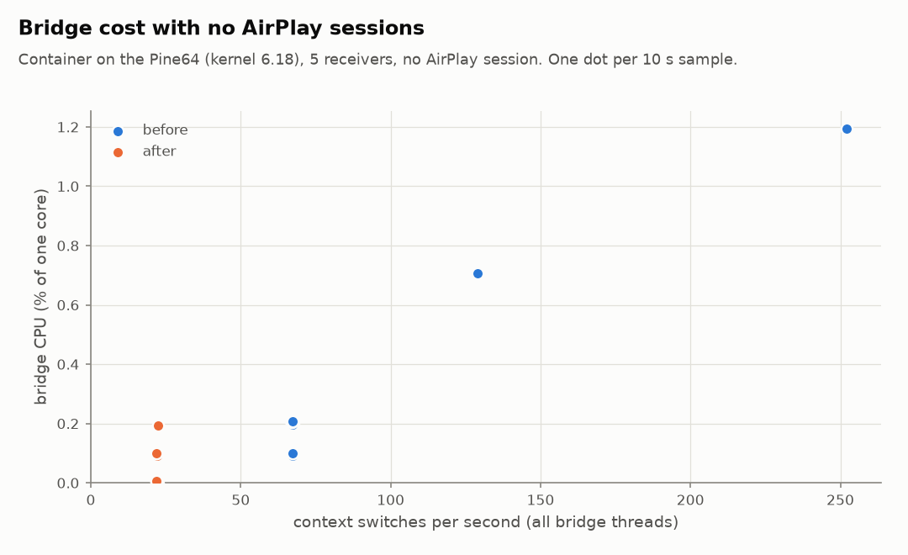
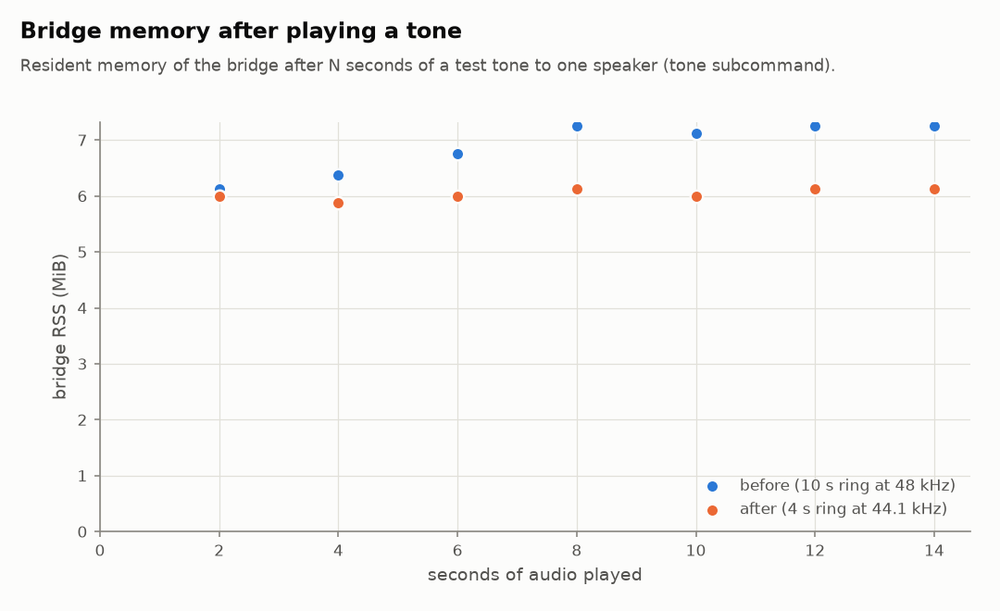
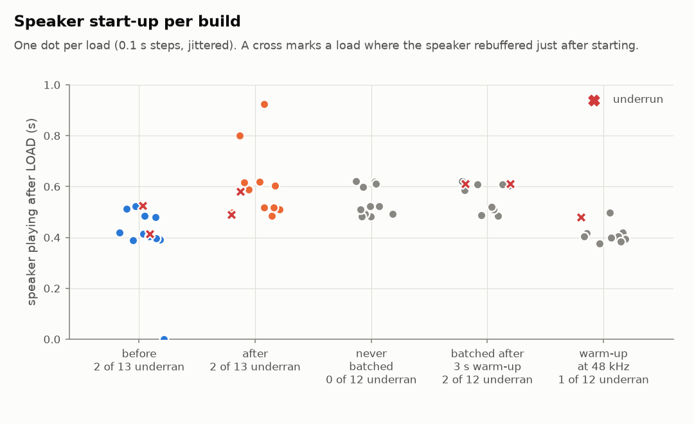

# CPU and memory tuning

Measured on the Pine64 test host (Allwinner A64, 4 × Cortex-A53, 1 GB RAM), streaming to a
Nest Audio. "Before" is commit 390da8f, "after" is the commit that adds this file.
Data, plotting and measurement scripts are in [`tuning/`](tuning/).

## What changed

| change | why |
|---|---|
| Output 44.1 kHz by default (`-r, --rate` picks 44100 or 48000) | AirPlay senders send 44.1 kHz, so shairport-sync no longer resamples every stream |
| HTTP clients are woken once per 40 ms of new audio, not per write | one wake-up and one small TCP segment per shairport-sync write was the bridge's main cost while streaming |
| Client wait without new audio: 10 ms → 100 ms | the silence feed and disconnects don't need 10 ms resolution |
| Per-device control thread ticks every 1 s instead of 100 ms when the speaker isn't connected and no AirPlay session is active | idle receivers no longer wake 10 times a second; play-begin metadata still wakes the thread at once |
| Ring buffer 10 s → 4 s | a client never starts more than 1 s back, and falls behind only if the speaker stalls for over 3 s |
| HTTP send chunk 8 → 16 KiB | fewer `send` calls for a backlog |

## Results

### While streaming

<picture>
  <source media="(prefers-color-scheme: dark)" srcset="tuning/stream-cpu-dark.png">
  
</picture>

| build | runs | bridge CPU (mean) | context switches/s (mean) |
|---|---|---|---|
| before | 13 | 1.25 % | 168 |
| after | 13 | 0.79 % | 81 |

These figures cover the bridge only. The larger saving should be in shairport-sync, which no
longer resamples 44.1 → 48 kHz. That part is **not measured**: it needs a real AirPlay
sender, and pyatv cannot stream to shairport-sync's AirPlay 2 mode. In an earlier iPhone
session, a playing shairport-sync used about 3.6 % of a core at 48 kHz.

A few "after" samples sit near 40 switches/s. In those runs the Python stand-in for
shairport-sync (`tests/fake_sps.py`, which computes its tone in pure Python) delivered its
audio in larger bursts.

### Idle (no AirPlay session)

<picture>
  <source media="(prefers-color-scheme: dark)" srcset="tuning/idle-dark.png">
  
</picture>

| build | samples | bridge CPU (mean) | context switches/s |
|---|---|---|---|
| before | 10 | 0.33 % (0.17 % without the two outliers) | 67 (8 of 10 samples) |
| after | 10 | 0.07 % | 22 |

Container with 5 receivers, both builds on kernel 6.18. The two high "before" samples
(129 and 252 switches/s) were consecutive and are unexplained, probably Cast or mDNS
traffic; they are kept in the data.

### Memory

<picture>
  <source media="(prefers-color-scheme: dark)" srcset="tuning/memory-dark.png">
  
</picture>

The ring buffer is allocated up front but becomes resident only as it fills. Before, it grew
for 10 s to 1.9 MB; now it stops at 0.7 MB. That saves about 1.1 MiB per speaker that has
played: 7.2 → 6.1 MiB in this test. The other processes (shairport-sync about 6.5 MB PSS
each, nqptp, avahi) are unchanged.

### Start-up and underruns

<picture>
  <source media="(prefers-color-scheme: dark)" srcset="tuning/startup-dark.png">
  
</picture>

| build | loads | playing after LOAD (mean) | loads that underran |
|---|---|---|---|
| before (48 kHz) | 13 | 0.41 s | 2 |
| after (44.1 kHz) | 13 | 0.59 s | 2 |
| experiment: never batched | 12 | 0.53 s | 0 |
| experiment: batched after a 3 s warm-up | 12 | 0.57 s | 2 |
| experiment: warm-up, at 48 kHz | 12 | 0.42 s | 1 |

* **Underruns don't depend on the build.** Every variant, the old one included, sometimes
  rebuffers about a second after starting. An early small sample suggested that batching
  caused it, and a "warm-up" variant (per-write wake-ups for a connection's first 3 s) was
  tried; with more runs, the differences are within noise, so the warm-up was dropped.
* **44.1 kHz starts about 0.15 s later.** Both 48 kHz builds start about 0.4 s after LOAD,
  both 44.1 kHz builds about 0.6 s. The Cast receiver apparently waits for a fixed amount of
  data, not a fixed duration. If start time matters more than shairport-sync's resampling
  cost, use `--rate 48000`.

## Method

* The bridge's streaming and memory tests run it natively next to the container with
  `tests/fake_sps.py` as the source (`collect.sh`, `collect_mem.sh`); the idle test samples
  the deployed container (`idle.sh`).
* CPU is utime + stime from `/proc/<pid>/stat`, counted in 10 ms ticks, so single samples
  fall in 0.25 % (4 s) or 0.1 % (10 s) steps. The plots jitter the dots so that equal
  values stay visible.
* Context switches are the voluntary plus involuntary switches of all bridge threads, from
  `/proc/<pid>/task/*/status`.
* Charts: `docker run --rm -v "$PWD/docs/tuning:/t" -w /t <python image with matplotlib> python plot.py`.

The streaming and memory runs used kernel 6.6.62. That kernel crashed repeatedly in its
scheduler under this test load (container plus a second, native bridge), so the host moved
to 6.18.44. The idle comparison and the final integration test ran on 6.18.
